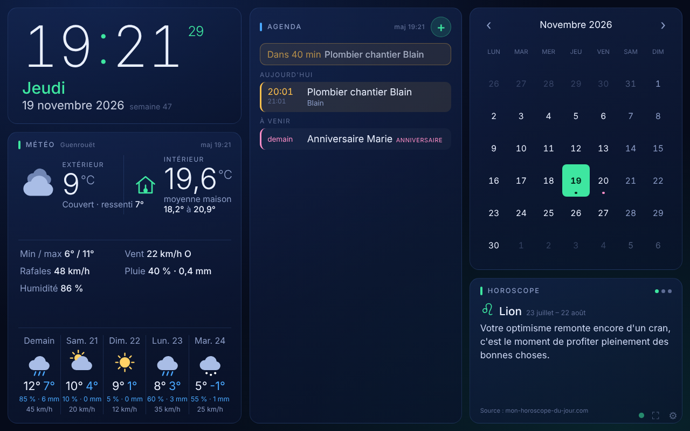

# Tableau de bord tablette

Tableau de bord personnel pour une Samsung Galaxy Tab A 10.1 (SM-T580) en mode paysage, 24 h/24.

## Modules

1. Horloge : heure, jour, date, numéro de semaine.
2. Météo de Guenrouët (Open-Meteo, gratuit, sans clé) : température, ressenti, vent, rafales, pluie, humidité, prévisions sur 5 jours.
3. Température intérieure : moyenne des radiateurs Atlantic Cozytouch.
4. Agenda Google : rendez-vous du jour, à venir, anniversaires, alerte avant un rendez-vous ; ajout, modification et suppression.
5. Calendrier mensuel.
6. Horoscope du jour (Lion, Sagittaire, Vierge), source mon-horoscope-du-jour.com.

## Architecture

1. `index.html`, `css/`, `js/` : l'affichage, en JavaScript simple sans compilation, hébergé sur GitHub Pages.
2. `apps-script/Code.gs` : le moteur, à installer dans Google Apps Script (voir `apps-script/INSTALLATION.md`).
   Il lit et modifie Google Agenda, récupère l'horoscope et lit Cozytouch.
3. L'adresse du moteur et son code secret sont saisis dans les réglages de la tablette et n'apparaissent jamais dans ce dépôt.

Sans moteur configuré, l'application fonctionne en mode démo (voyant orange).

## Coût

0 €.

## Limite connue

Cozytouch n'a pas d'accès officiel pour les développeurs. Le moteur utilise la même méthode que Home Assistant.
Si Atlantic change son système, la température intérieure affichera « ancienne mesure » jusqu'à la correction du code.
